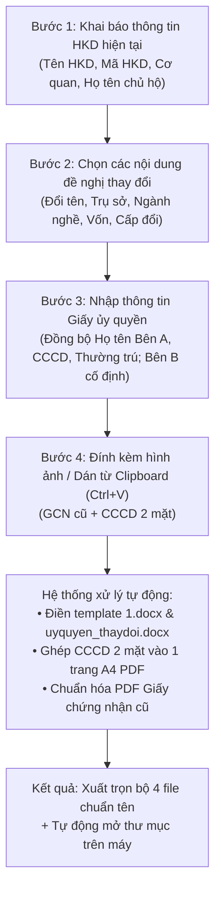

# HỆ THỐNG TỰ ĐỘNG HÓA HỒ SƠ HỘ KINH DOANH (HDK_BOT & WEB APP)
## TÀI LIỆU ĐẶC TẢ NGHIỆP VỤ & HƯỚNG DẪN KIẾN TRÚC KỸ THUẬT TOÀN DIỆN

> **Mục đích tài liệu:** Tài liệu này cung cấp cái nhìn chi tiết và đầy đủ nhất về nghiệp vụ hành chính, cấu trúc hệ thống, quy trình thực hiện, danh mục tài liệu đầu ra, danh sách placeholder và các giải pháp kỹ thuật cốt lõi trong dự án tạo lập hồ sơ Đăng ký Hộ Kinh Doanh. Tài liệu được thiết kế để bất kỳ thành viên nào (lập trình viên, chuyên viên nghiệp vụ, quản lý dự án) đọc vào đều có thể hiểu tường tận hệ thống đang làm gì và cách thức vận hành ra sao.

---

## 1. TỔNG QUAN DỰ ÁN & BÀI TOÁN NGHIỆP VỤ

### 1.1. Bối cảnh bài toán
Tại Việt Nam, thủ tục đăng ký thành lập mới và thay đổi nội dung đăng ký Hộ kinh doanh (HKD) được quy định chặt chẽ theo **Nghị định 01/2021/NĐ-CP** và **Thông tư 02/2023/TT-BKHĐT**. Các bộ hồ sơ nộp lên Cơ quan đăng ký kinh doanh cấp quận/huyện (hoặc nộp trực tuyến qua Cổng Dịch vụ công Quốc gia) đòi hỏi:
1. Độ chuẩn xác 100% về mặt định dạng văn bản (font chữ Times New Roman 14pt, lề trang, bảng biểu, dấu chấm `....`).
2. Đồng bộ chặt chẽ giữa thông tin trên Giấy đề nghị, Giấy ủy quyền và Bản sao giấy tờ pháp lý (CCCD, Giấy chứng nhận cũ).
3. Đầy đủ cả file văn bản gốc (`.docx`) và file ký số/nộp scan (`.pdf`).

Trước đây, việc soạn thảo thủ công các văn bản này mất nhiều thời gian, dễ nhầm lẫn mã ngành cấp 4, sai sót thông tin người đại diện hoặc lỗi định dạng Word khi chuyển đổi sang PDF. Dự án **HDK_BOT & Web App** ra đời nhằm tự động hóa hoàn toàn quy trình này.

### 1.2. Kiến trúc 2 phân hệ độc lập

```
                            ┌───────────────────────────────────────────────┐
                            │               HỆ THỐNG HDK_BOT                │
                            └───────────────────────┬───────────────────────┘
                                                    │
                 ┌──────────────────────────────────┴──────────────────────────────────┐
                 ▼                                                                     ▼
   ┌───────────────────────────────┐                                     ┌───────────────────────────────┐
   │         PHÂN HỆ 1             │                                     │         PHÂN HỆ 2             │
   │    ĐĂNG KÝ THÀNH LẬP HKD      │                                     │    THAY ĐỔI NỘI DUNG HKD      │
   ├───────────────────────────────┤                                     ├───────────────────────────────┤
   │ • Nền tảng: Discord Bot       │                                     │ • Nền tảng: Web Application   │
   │ • Input: Slash Command/Modal  │                                     │ • Input: Web Form SPA         │
   │ • Template: templates/2.docx  │                                     │ • Template: templates/1.docx  │
   │ • Giữ nguyên 100% không đổi   │                                     │ • Hỗ trợ Paste ảnh Ctrl + V   │
   │                               │                                     │ • Xuất trọn bộ 4 file chuẩn   │
   └───────────────────────────────┘                                     └───────────────────────────────┘
```

1. **Phân hệ 1: Đăng ký thành lập Hộ kinh doanh mới (Discord Bot):**
   - Được giữ nguyên vẹn 100% trong mã nguồn (`service/register_hkd.go`, `service/discord.go`).
   - Tương tác thông qua các lệnh Slash Command trên máy chủ Discord, điền thông tin vào mẫu `templates/2.docx` và `templates/uyquyen_dktlhkd.docx`.

2. **Phân hệ 2: Thay đổi nội dung đăng ký Hộ kinh doanh (Web Application):**
   - Chạy trên cổng máy chủ cục bộ: **`http://localhost:8080`**.
   - Được thiết kế dưới dạng Single-Page Application (SPA) trực quan, có giao diện Tiếng Việt đẹp mắt.
   - Hỗ trợ đầy đủ các nghiệp vụ thay đổi phức tạp: đổi tên, đổi trụ sở, điều chỉnh vốn, cấp đổi sang GCN và thay đổi ngành nghề tuần tự (bổ sung/bỏ bớt nhiều dòng).
   - **Tính năng dán ảnh từ Clipboard (`Ctrl + V`)**: Cho phép người dùng chụp ảnh màn hình hoặc copy ảnh giấy tờ và dán trực tiếp vào trình duyệt mà không cần lưu file tạm.
   - **Lưu trực tiếp vào thư mục đích giống lúc đăng ký thành lập**: Toàn bộ 4 file được lưu thẳng vào thư mục trên máy tính: `Desktop/GPKD/{tên_chủ_hộ}/`. Hệ thống tự động mở cửa sổ thư mục trên Windows Explorer (`explorer.exe`) ngay khi hoàn tất. Tuyệt đối không gửi/tải lên đâu để người dùng không phải tốn thêm một lần bấm tải về.
   - Tự động xuất đầy đủ bộ **4 file chuẩn hóa** (gồm 2 file Word và 2 file PDF).

---

## 2. QUY TRÌNH NGHIỆP VỤ 4 BƯỚC TRÊN WEB APP

Khi người dùng mở giao diện `http://localhost:8080`, hệ thống dẫn dắt người dùng qua 4 bước thực hiện mạch lạc:



### Bước 1: Thông tin Hộ kinh doanh hiện tại
- **Tên hộ kinh doanh hiện tại:** Điền bằng chữ in hoa (ví dụ: `HỘ KINH DOANH HOA TƯƠI` hoặc `HOA TƯƠI`). Hệ thống tự động chuẩn hóa tiền tố.
- **Mã số hộ kinh doanh / MST:** Mã số thuế hoặc số Giấy chứng nhận đã được cấp (ví dụ: `0319888999`).
- **Cơ quan tiếp nhận / Xã, Phường:** Địa danh hành chính nơi nộp hồ sơ (ví dụ: `Phường 5` hoặc `Phường Bình Trị Đông B`). Giá trị này được dùng đồng bộ cho cả tiêu ngữ văn bản và nơi gửi.
- **Họ và tên người ký / Chủ hộ:** Tên đầy đủ của chủ hộ kinh doanh (ví dụ: `NGUYỄN THỊ HUỲNH NHƯ`). Hệ thống tự động in hoa và đồng bộ sang Giấy ủy quyền.

### Bước 2: Các nội dung đề nghị thay đổi (Bật/tắt theo nhu cầu)
Người dùng chỉ cần tick chọn những mục nào mà Hộ kinh doanh thực tế có thay đổi:
1. **Thay đổi tên hộ kinh doanh:**
   - Nhập tên HKD mới (tự động in hoa, ví dụ: `HỘ KINH DOANH HOA TƯƠI SÀI GÒN`).
2. **Thay đổi địa chỉ trụ sở kinh doanh:**
   - Nhập: Số nhà, đường/phố/tổ/ấp (`{sonha}`).
   - Phường/Xã (`{co_quan}`): Mặc định tự động điền theo Cơ quan ở Bước 1 (có thể chỉnh sửa).
   - Tỉnh/Thành phố (`{thanh_pho}`): Mặc định là `Thành phố Hồ Chí Minh`.
   - Số điện thoại liên hệ (`{sdt}`).
   - **Tùy chọn bổ sung địa chỉ vào thông tin thêm (`{thongtinthem}`):** Giao diện cung cấp checkbox kèm 1 ô `input text` nằm ngay bên dưới. Người dùng vẫn giữ dấu tick và có thể tự nhập/chỉnh sửa linh hoạt bất kỳ nội dung nào muốn bổ sung vào mục `{thongtinthem}` (ví dụ: số tầng, số phòng, tên tòa nhà...); nếu không có thông tin thì trường này sẽ được để trống `""`.
3. **Thay đổi ngành, nghề kinh doanh (Quy trình tuần tự):**
   - **Bổ sung ngành nghề (Bảng 5):** Thêm các dòng ngành nghề mới. Nhập Mã ngành 4 số (hệ thống tự động tra cứu và gợi ý tên ngành từ catalog `nganh_nghe.json`), điền chi tiết ngành nghề và tick chọn xem có phải là Ngành nghề chính hay không (**Quy định bắt buộc:** Chỉ được chọn tối đa 1 ngành chính duy nhất, hệ thống tự động bỏ chọn ở các dòng khác khi tick dòng mới).
   - **Bỏ bớt ngành nghề (Bảng 6):** Thêm các dòng ngành nghề không còn hoạt động để rút bớt khỏi giấy phép. Có cột tick chọn **Ngành chính** nếu ngành nghề bị bỏ là ngành nghề chính hiện tại của hộ kinh doanh (**Quy định bắt buộc:** Chỉ chọn tối đa 1 ngành chính).
4. **Thay đổi vốn kinh doanh:**
   - Nhập: Vốn mới bằng số và chữ (ví dụ: `200.000.000 VNĐ (Hai trăm triệu đồng)`), thời điểm thay đổi và chọn hình thức (`Tăng vốn` hoặc `Giảm vốn`).
5. **Đăng ký cấp đổi sang Giấy chứng nhận đăng ký hộ kinh doanh:**
   - Tự động đánh dấu hình thức `☑ Cá nhân` vào văn bản.
   - Nhập Số lao động (nếu có; nếu không có thì bắt buộc để trống).
   - *Lưu ý quan trọng:* Nếu người dùng **không** chọn cấp đổi, hệ thống sẽ tự động chuyển toàn bộ các placeholder ở nửa dưới văn bản về định dạng dấu chấm `....` hoặc để trống theo đúng quy định.

### Bước 3: Thông tin Giấy ủy quyền (`templates/uyquyen_thaydoi.docx`)
- **Bên ủy quyền (Bên A):** Tự động kế thừa Họ tên chủ hộ từ Bước 1; người dùng nhập bổ sung: Ngày sinh, Số CCCD, Ngày cấp, Nơi cấp (mặc định: `Cục Cảnh sát QLHC về TTXH`), Địa chỉ thường trú.
- **Bên nhận ủy quyền (Bên B):** Được hệ thống cố định thông tin người nhận ủy quyền theo ủy quyền thực tế:
  - Ông: **TRẦN NGỌC NAM**
  - Ngày sinh: `25/07/2003`
  - Số định danh cá nhân: `075203000065`
  - Cấp ngày: `25/08/2022` tại `Cục Trưởng Cục Cảnh Sát Quản Lý Hành Chính Về Trật Tự Xã Hội`
  - Thường trú tại: `4465/9/40 Nguyễn Cửu Phú, Phường Tân Tạo, Thành phố Hồ Chí Minh`

### Bước 4: Đính kèm & Dán hình ảnh trực tiếp từ Clipboard (`Ctrl + V`)
Giao diện cung cấp 3 vùng thao tác:
1. **Giấy chứng nhận đăng ký HKD cũ:** Nhấn `Ctrl + V` để dán ảnh chụp hoặc chọn file PNG/JPG/PDF từ máy tính.
2. **CCCD Mặt trước:** Nhấn `Ctrl + V` để dán ảnh mặt trước.
3. **CCCD Mặt sau:** Nhấn `Ctrl + V` để dán ảnh mặt sau.
- **Tính năng ghép thông minh:** Hệ thống tự động ghép 2 mặt CCCD vào 1 trang A4 PDF duy nhất theo tỷ lệ chuẩn, căn giữa đối xứng trên - dưới.

---

## 3. DANH MỤC 4 FILE ĐẦU RA VÀ QUY CHUẨN ĐẶT TÊN

Tất cả các file sau khi tạo sẽ được lưu vào thư mục:
```text
output/{tên_chủ_hộ}/
```
*(Trong đó `{tên_chủ_hộ}` là họ tên viết thường không dấu hoặc có dấu nối, ví dụ: `Desktop/GPKD/nguyễn_thị_huỳnh_như/`)*.

Toàn bộ 4 file tuân thủ chính xác quy tắc đặt tên theo mẫu hồ sơ nộp hành chính:

| STT | Tên file chuẩn hóa | Định dạng | Mục đích sử dụng trong hồ sơ pháp lý |
| :---: | :--- | :---: | :--- |
| **1** | `GIẤY ĐỀ NGHỊ ĐĂNG KÝ THAY ĐỔI NỘI DUNG ĐĂNG KÝ HỘ KINH DOANH_{HỌ VÀ TÊN}_0001.docx` | DOCX | Bản thảo văn bản đề nghị thay đổi theo mẫu Thông tư 02/2023/TT-BKHĐT, có thể mở để chỉnh sửa thêm trong Microsoft Word. |
| **2** | `GIẤY ỦY QUYỀN_{HỌ VÀ TÊN}_0001.docx` | DOCX | Giấy ủy quyền giải quyết thủ tục hành chính nộp hồ sơ và nhận kết quả (bản Word). |
| **3** | `GIẤY CHỨNG NHẬN ĐĂNG KÝ HỘ KINH DOANH_{HỌ VÀ TÊN}_0001.pdf` | PDF | Bản PDF Giấy chứng nhận cũ (chuẩn hóa trang A4 sắc nét). |
| **4** | `BẢN SAO GIẤY TỜ PHÁP LÝ CỦA CÁ NHÂN_{HỌ VÀ TÊN}_0001.pdf` | PDF | Bản PDF ghép 2 mặt CCCD (Mặt trước ở nửa trên, Mặt sau ở nửa dưới) trên 1 trang A4 chuẩn. |

---

## 4. BẢNG THỐNG KÊ CHI TIẾT CÁC PLACEHOLDER

### 4.1. File `templates/1.docx` (Giấy đề nghị thay đổi - 39 vị trí)
Văn bản được chia thành 2 phân vùng rõ rệt: **Phần Trên (Upper)** và **Phần Dưới (Lower)** tính từ mốc `ĐĂNG KÝ CẤP ĐỔI SANG GIẤY CHỨNG NHẬN`.

| STT | Placeholder | Phân vùng | Ý nghĩa | Quy tắc điền & Giá trị mặc định |
| :---: | :--- | :---: | :--- | :--- |
| **1** | `{ten_hkd}` | Upper (Góc trái) | Tên HKD hiện tại | Chữ in hoa, lược bỏ tiền tố: `HOA TƯƠI` |
| **2** | `{co_quan}` | Upper (Tiêu ngữ) | Địa danh ban hành | Lấy từ Cơ quan tiếp nhận (vd: `Phường 5`) |
| **3,4,5** | `{ngay}`, `{thang}`, `{nam}` | Upper (Tiêu ngữ) | Ngày tháng năm nộp | Lấy ngày tháng năm hiện tại hệ thống (vd: `09/11/2026`) |
| **6** | `{co_quan}` | Upper (Kính gửi) | Cơ quan tiếp nhận | `Kính gửi: Ủy Ban nhân dân {co_quan}` |
| **7** | `{ten_hkd}` | Upper (Dòng 1) | Tên HKD (in hoa) | `HỘ KINH DOANH {ten_hkd}` |
| **8** | `{ma_hkd}` | Upper (Dòng 2) | Mã số HKD / MST | Mã số thuế / Giấy phép hiện tại |
| **9** | `{ten_hkd_moi }` | Upper (Mục 1) | Tên HKD sau thay đổi | **Nếu có thay đổi tên:** Điền tên mới (chữ in hoa).<br>**Nếu không đổi:** Lấp đầy dòng chấm `................` (khoảng 59 chấm) để cân đối dòng. |
| **10** | `{sonha}` | Upper (Mục 2) | Trụ sở: Số nhà, đường | Số nhà mới (nếu có đổi). Nếu không đổi: điền dòng chấm đầy đủ `................` |
| **11** | `{co_quan}` | Upper (Mục 2) | Trụ sở: Xã/Phường | Phường/Xã mới (nếu có). Điền `................` (~38 chấm) cân đối lề phải nếu không đổi. |
| **12** | `{thanh_pho}` | Upper (Mục 2) | Trụ sở: Tỉnh/TP | **Mặc định:** `Thành phố Hồ Chí Minh`. Nếu không có: điền `................` (~19 chấm) thẳng hàng lề phải. |
| **13** | `{sdt}` | Upper (Mục 2) | Trụ sở: Điện thoại | SĐT liên hệ.<br>**Nếu không có:** Điền dòng chấm cân đối `....................................` (36 chấm) đứng trước chữ `Fax (nếu có):`, không bị ngắn hay dính chữ. |
| **14** | `{vonkinhdoanhmoi}` | Upper (Mục 3) | Vốn sau thay đổi | Vốn mới kèm chữ. Nếu không đổi: điền `................` |
| **15** | `{thoigianthaydoivon}` | Upper (Mục 3) | Thời điểm đổi vốn | Ngày tháng năm đổi vốn. Nếu không đổi: điền `................` |
| **16** | `{hinhthucthaydoivon}` | Upper (Mục 3) | Hình thức thay đổi | `Tăng vốn` hoặc `Giảm vốn`. Nếu không đổi: điền `................` |
| **17** | `{stt_bosung}` | Upper (Bảng 5) | STT ngành bổ sung | Tạo số dòng động tương ứng số ngành bổ sung |
| **18** | `{nganhnghe_bosung}` | Upper (Bảng 5) | Tên ngành bổ sung | Tên ngành + diễn giải chi tiết (Times New Roman 14pt) |
| **19** | `{ma_bosung}` | Upper (Bảng 5) | Mã ngành bổ sung | Mã ngành cấp 4 căn giữa |
| **20** | `{nganh_bs_chinh}` | Upper (Bảng 5) | Ngành chính bổ sung | Đánh dấu `X` nếu là ngành chính (chỉ chọn tối đa 1 ngành chính), để trống nếu không |
| **21** | `{stt_bo}` | Upper (Bảng 6) | STT ngành bỏ bớt | Tạo số dòng động tương ứng số ngành bỏ |
| **22** | `{nganhnghe_bo}` | Upper (Bảng 6) | Tên ngành bỏ bớt | Tên ngành bị bỏ (tránh nhầm lẫn với Bảng 5) |
| **23** | `{ma_bo}` | Upper (Bảng 6) | Mã ngành bỏ bớt | Mã ngành cấp 4 căn giữa |
| **24** | `{nganh_bo_chinh}` | Upper (Bảng 6) | Cột ngành chính Bảng 6 | Đánh dấu `X` nếu ngành bị bỏ là ngành chính (chỉ chọn tối đa 1 ngành chính). Để trống `""` nếu không phải hoặc không có dữ liệu |
| **25** | `{stt_sua}` | Upper (Bảng 7) | Sửa ngành chính | **Bắt buộc để trống hoàn toàn `""`** nếu không có dữ liệu |
| **26** | `{nganhnghe_sua}` | Upper (Bảng 7) | Tên ngành sửa | **Bắt buộc để trống hoàn toàn `""`** nếu không có dữ liệu (không điền dấu chấm) |
| **27** | `{ma_sua}` | Upper (Bảng 7) | Mã ngành sửa | **Bắt buộc để trống hoàn toàn `""`** nếu không có dữ liệu |
| **28** | `{thongtinthem}` | Upper (Mục 8) | Đăng ký bổ sung/hiệu đính | Điền nội dung hiệu đính nếu có.<br>**Nếu không có data:** **Bắt buộc để trống hoàn toàn `""`** (không điền dấu chấm). |
| **29** | `{ten_hkd}` | Lower (Mục 1) | Tên HKD cấp đổi | Nếu CÓ cấp đổi: điền tên HKD. Nếu KHÔNG: điền dòng chấm đầy đủ |
| **30** | `{sonha}` | Lower (Mục 2) | Trụ sở cấp đổi | Nếu CÓ cấp đổi: điền số nhà. Nếu KHÔNG: điền dòng chấm đầy đủ |
| **31** | `{co_quan}` | Lower (Mục 2) | Phường/Xã cấp đổi | Nếu CÓ cấp đổi: điền Phường/Xã. Nếu KHÔNG: điền dòng chấm cân đối lề phải |
| **32** | `{thanh_pho}` | Lower (Mục 2) | Tỉnh/TP cấp đổi | Nếu CÓ cấp đổi: `Thành phố Hồ Chí Minh`. Nếu KHÔNG: điền dòng chấm cân đối lề phải |
| **33** | `{sdt}` | Lower (Mục 2) | Điện thoại cấp đổi | Nếu CÓ cấp đổi: điền SĐT. Nếu KHÔNG: điền dòng chấm cân đối 36 chấm |
| **34** | `{stt}` | Lower (Bảng 9) | STT ngành cấp đổi | Nếu CÓ cấp đổi: tạo danh sách ngành. Nếu KHÔNG: dòng chấm `....` |
| **35** | `{ten_nganh}` | Lower (Bảng 9) | Tên ngành cấp đổi | Nếu CÓ cấp đổi: điền tên ngành. Nếu KHÔNG: dòng chấm `....` |
| **36** | `{ma_nganh}` | Lower (Bảng 9) | Mã ngành cấp đổi | Nếu CÓ cấp đổi: điền mã ngành. Nếu KHÔNG: dòng chấm `....` |
| **37** | `{nganh_chinh}` | Lower (Bảng 9) | Ngành chính cấp đổi | Đánh dấu `X` nếu là ngành chính |
| **38** | `{vonkinhdoanh}` | Lower (Mục 4) | Vốn cấp đổi | Nếu CÓ cấp đổi: điền vốn mới. Nếu KHÔNG: điền `................` |
| **39** | `{solaodong}` | Lower (Mục 5.2)| Số lao động | **Nếu có nhập:** Điền số lao động.<br>**Nếu KHÔNG nhập hoặc KHÔNG cấp đổi:** Bắt buộc để trống `""`. |

---

### 4.2. File `templates/uyquyen_thaydoi.docx` (Giấy ủy quyền - 15 vị trí)

| STT | Placeholder | Vị trí xuất hiện | Dữ liệu điền vào |
| :---: | :--- | :--- | :--- |
| **1** | `{coquan}` | Tiêu ngữ góc phải trên | Địa danh ban hành giấy ủy quyền (Lấy theo `{co_quan}`) |
| **2,3,4** | `{ngay}`, `{thang}`, `{nam}` | Tiêu ngữ góc phải trên | Ngày, tháng, năm lập giấy ủy quyền |
| **5** | `{hovaten}` | Bên ủy quyền (Bên A): Ông (Bà) | Họ và tên chủ hộ kinh doanh (in hoa) |
| **6** | `{ngaysinh}` | Bên ủy quyền (Bên A): Ngày sinh | Ngày sinh của chủ hộ (dd/mm/yyyy) |
| **7** | `{cccd}` | Bên ủy quyền (Bên A): Số định danh | Số CCCD 12 số của chủ hộ |
| **8** | `{ngaycap}` | Bên ủy quyền (Bên A): Cấp ngày | Ngày cấp CCCD (dd/mm/yyyy) |
| **9** | `{coquancap}` | Bên ủy quyền (Bên A): Nơi cấp | Mặc định: `Cục Cảnh sát QLHC về TTXH` |
| **10** | `{diachithuongtru}` | Bên ủy quyền (Bên A): Thường trú | Địa chỉ thường trú theo CCCD |
| **11** | `{hovaten}` | Nội dung ủy quyền | `...thay mặt ông/bà {hovaten}...` |
| **12** | `{coquan}` | Nội dung ủy quyền | `...đến Phòng Kinh tế, Hạ tầng và Đô thị {coquan}...` |
| **13,14,15**| `{ngay}`, `{thang}`, `{nam}` | Thời hạn ủy quyền | `Từ ngày {ngay} tháng {thang} năm {nam} cho tới khi xong việc` |

---

## 5. GIẢI PHÁP KỸ THUẬT CỐT LÕI (TECHNICAL DEEP-DIVE)

### 5.1. Khắc phục lỗi Word COM Error `0x800A1401`
- **Nguyên nhân cốt tử:** Trong đặc tả Office Open XML (OOXML), thẻ `<w:sdt>` là thẻ hệ thống đại diện cho **Structured Document Tag** (Content Controls, form fields, checkbox). Trong mã nguồn cũ, hàm tìm kiếm chuỗi con `replaceSplitPlaceholder(part, "sdt", ...)` đã vô tình tìm thấy thẻ `<w:sdt>` của Word, lùi lại tìm `{` phía trước và cắt đứt thẻ XML hệ thống, dẫn đến file Word bị hỏng cấu trúc và Microsoft Word từ chối mở (Error 0x800A1401).
- **Giải pháp xử lý:** Áp dụng biểu thức chính quy an toàn:
  ```go
  pattern := `\{[^{}]*?` + regexp.QuoteMeta(placeholderName) + `[^{}]*?\}`
  ```
  Nhờ điều kiện `[^{}]*?`, regex đảm bảo chỉ tìm kiếm và thay thế nội dung nằm trọn vẹn giữa cặp dấu `{` và `}`, tuyệt đối không bao giờ xâm lấn hoặc làm hỏng bất kỳ thẻ `<w:sdt>` hay thẻ OOXML nào của tài liệu.

### 5.2. Công nghệ dán ảnh trực tiếp từ Clipboard (`Ctrl + V`)
- Sử dụng **HTML5 Clipboard API** kết hợp `FileReader`:
  ```javascript
  zone.addEventListener('paste', (e) => {
    const items = (e.clipboardData || window.clipboardData).items;
    for (let item of items) {
      if (item.type.indexOf('image') !== -1) {
        const blob = item.getAsFile();
        const reader = new FileReader();
        reader.onload = (event) => {
          previewImg.src = event.target.result;
          hiddenInput.value = event.target.result; // Data URL Base64
        };
        reader.readAsDataURL(blob);
        e.preventDefault();
        break;
      }
    }
  });
  ```
- Người dùng có thể nhấn `Ctrl + V` tại bất kỳ ô dán ảnh nào. Hệ thống ngay lập tức trích xuất dữ liệu nhị phân của ảnh, hiển thị xem trước tức thì và gửi lên server dưới dạng chuỗi Base64 chuẩn.

### 5.3. Ghép 2 mặt CCCD thành 1 trang PDF A4 chuẩn pháp lý
- Sử dụng thư viện `github.com/signintech/gopdf` tính toán chính xác tọa độ trên khổ A4 chuẩn (`595.28 x 841.89 pt`):
  - Kích thước hiển thị thẻ CCCD: chiều rộng `420 pt`, chiều cao `265 pt`.
  - Căn lề ngang trung tâm: `posX = (pageW - 420) / 2`.
  - Mặt trước bố trí tại nửa trên: `posY1 = 80.0`.
  - Mặt sau bố trí tại nửa dưới: `posY2 = 420.0`.
  - Kết quả xuất ra file `BẢN SAO GIẤY TỜ PHÁP LÝ CỦA CÁ NHÂN_{HỌ VÀ TÊN}_0001.pdf` đạt tỷ lệ chuẩn như một bản photocopy công chứng.

### 5.4. Chuyển đổi DOCX sang PDF bằng Microsoft Word COM Automation
- Sử dụng Microsoft Word COM Automation (`Word.Application`) thông qua script PowerShell ẩn. Cách làm này mang lại:
  - Độ chính xác 100% về font chữ Times New Roman, khoảng cách dòng, phân trang và ký hiệu checkbox Wingdings.
  - Tốc độ xử lý nhanh, không bị lệch trang hay lỗi hiển thị bảng biểu như các công cụ mã nguồn mở thông thường.

### 5.5. Xử lý Placeholder bị phân mảnh OOXML (`ten_hkd_moi`) & thứ tự ưu tiên
- **Thực trạng:** Trong file mẫu Word `templates/1.docx`, cụm placeholder `{ten_hkd_moi }` bị Word chia tách thành 3 thẻ `<w:t>` riêng biệt nằm trong các run `<w:r>` khác nhau: `<w:t>{ten_</w:t>`, `<w:t>hkd_</w:t>`, `<w:t>moi } </w:t>`. Do đó, các thuật toán tìm kiếm chuỗi con thông thường đều thất bại (`Index = -1`).
- **Giải pháp:** Xây dựng biểu thức regex phân rã theo dấu gạch dưới:
  ```go
  parts := strings.Split(placeholderName, "_")
  for i := range parts {
      parts[i] = regexp.QuoteMeta(parts[i])
  }
  pattern := `\{[^{}]*?` + strings.Join(parts, `[^{}]*?`) + `[^{}]*?\}`
  ```
  Đồng thời, hệ thống **bắt buộc ưu tiên thay thế `{ten_hkd_moi}` trước `{ten_hkd}`** để loại trừ hoàn toàn nguy cơ `{ten_hkd_moi}` bị nhận diện nhầm thành chuỗi con của `{ten_hkd}`.

### 5.6. Quy chuẩn độ dài dòng chấm `....` tỉ lệ cân đối lề phải
- Để loại bỏ hoàn toàn hiện tượng dòng chấm bị ngắn thụt lùi hoặc thừa dài gây lệch trang, hệ thống áp dụng hệ số chấm tỉ lệ nghịch với chiều dài nhãn tiêu đề:
  - Dòng độc lập / `{sonha}` / `{ten_hkd_moi}` khi không đổi: **59 chấm** (`dotsFullLine`).
  - Dòng `Xã/Phường/Đặc khu: ` (19 ký tự): **38 chấm** (`dotsCoQuan`).
  - Dòng `Tỉnh/Thành phố trực thuộc trung ương: ` (38 ký tự): **19 chấm** (`dotsThanhPho`).
  - Dòng `Điện thoại: `: **36 chấm** (`dotsPhone`) đứng trước `Fax (nếu có):`, đảm bảo cân đối đẹp mắt với dòng `Thư điện tử` phía dưới.
  - Kết quả: Toàn bộ các dòng chấm kết thúc thẳng tắp ngay mép lề phải của văn bản theo chuẩn thể thức hành chính Việt Nam.

### 5.7. Quy tắc để trống hoàn toàn `""` và Giới hạn 1 ngành chính
- **5 trường bắt buộc để trống `""` khi không có dữ liệu (không điền dấu chấm):**
  1. `{solaodong}`: Số lao động.
  2. `{stt_sua}`: Số thứ tự Bảng 7.
  3. `{nganhnghe_sua}`: Tên ngành nghề Bảng 7.
  4. `{ma_sua}`: Mã ngành Bảng 7.
  5. `{thongtinthem}`: Thông tin đăng ký bổ sung/hiệu đính Mục 8.
- **Giới hạn ngành chính:** Người dùng chỉ được phép chọn tối đa **1 ngành nghề chính duy nhất**. Trên giao diện Web, khi tick chọn một ngành chính, hệ thống sẽ tự động bỏ chọn ở tất cả các dòng khác; trên Backend, hệ thống kiểm duyệt lại một lần nữa để chỉ giữ duy nhất dòng ngành chính đầu tiên.

### 5.8. Tự động định dạng tách số điện thoại (Phone Formatting)
- **Trên giao diện Web:** Khi người dùng nhập hoặc dán 10 chữ số (ví dụ: `0903343425`), hệ thống tự động tách nhóm theo cấu trúc chuẩn: `0903 343 425`.
- **Trong file Word xuất ra:**
  - Số điện thoại được tự động phân tách nhóm: `0903 343 425`.
  - Có khoảng trắng ngăn cách giữa `Điện thoại: ` và số điện thoại, đồng thời đệm khoảng trắng bảo lưu (`xml:space="preserve"`) trước nhãn `Fax (nếu có):`, không bao giờ bị dính liền chữ `0903343425Fax`.

### 5.9. Bảo toàn khung viền bảng Mục 3 (Cấp đổi GCN) & Loại bỏ hoàn toàn khối Content Control `<w:sdt>`
- **Loại bỏ thẻ `<w:sdt>` trong template:** Microsoft Word mặc định chèn thẻ Content Control (`<w:sdt>`) kèm thuộc tính `w:placeholder`, khiến các trường khi để trống `""` sẽ tự động hiển thị dòng chấm xám `[......................]`. Hệ thống đã bóc tách (unwrap) toàn bộ 39 thẻ `<w:sdt>`, chuyển về văn bản thuần túy để các trường trống giữ được sự sạch sẽ tuyệt đối.
- **Khung bảng Mục 3 (Bảng 9):** Luôn tạo đủ 4 cột (`STT`, `Tên ngành`, `Mã ngành`, `Ngành, nghề KD chính`) với viền kẻ đầy đủ `<w:tcBorders>`, kể cả khi không có dữ liệu ngành nghề hoặc không chọn cấp đổi, đảm bảo bảng luôn có khung viền hoàn chỉnh, các ô trống không bị mất khung viền.

---

## 6. CẤU TRÚC THƯ MỤC DỰ ÁN

```text
D:\Code\HDK_BOT\
│
├── main.go                       # Điểm khởi động: chạy Web Server song song cùng Discord Bot
├── go.mod / go.sum               # Khai báo dependency Go
├── nganh_nghe.json               # Danh mục mã ngành kinh tế Việt Nam cấp 4 & diễn giải
├── hkd_bot.exe                   # File thực thi chạy toàn bộ hệ thống
│
├── templates/                    # Thư mục chứa các file Word biểu mẫu
│   ├── 1.docx                    # Mẫu Giấy đề nghị thay đổi nội dung ĐK HKD
│   ├── uyquyen_thaydoi.docx      # Mẫu Giấy ủy quyền thay đổi HKD
│   ├── 2.docx                    # Mẫu Đăng ký thành lập HKD mới (cho Discord Bot)
│   └── uyquyen_dktlhkd.docx      # Mẫu Giấy ủy quyền thành lập (cho Discord Bot)
│
├── web/                          # Thư mục mã nguồn Frontend Web App
│   └── index.html                # Giao diện SPA, form kê khai & xử lý dán ảnh Clipboard
│
├── service/                      # Thư mục chứa toàn bộ logic xử lý
│   ├── thaydoi_hkd.go            # Xử lý điền dữ liệu & bảng biểu cho templates/1.docx
│   ├── uyquyen.go                # Xử lý điền dữ liệu cho templates/uyquyen_thaydoi.docx
│   ├── pdf_converter.go          # Chuyển DOCX -> PDF, ghép ảnh CCCD, tạo DOCX nhúng ảnh
│   ├── web_server.go             # Khởi chạy HTTP Server & các REST API
│   ├── register_hkd.go           # Logic Đăng ký thành lập HKD (Discord Bot giữ nguyên)
│   ├── discord.go                # Xử lý kết nối và Slash Command Discord
│   ├── web_server_test.go        # Kiểm thử tích hợp tự động toàn bộ API và 4 file đầu ra
│   ├── pdf_converter_test.go     # Kiểm thử chuyển đổi PDF và nhúng ảnh
│   └── thaydoi_hkd_test.go       # Kiểm thử điền placeholder và cấu trúc OOXML
│
├── model/                        # Khai báo các cấu trúc dữ liệu Struct
│   └── model.go                  # Struct ThayDoiHKD, UyQuyenData, WebThayDoiSubmission...
│
└── output/                       # Thư mục lưu trữ kết quả hồ sơ theo từng chủ hộ
    └── {tên_chủ_hộ}/             # Chứa đủ 4 file chuẩn tên định dạng theo từng hồ sơ
```

---

## 7. HƯỚNG DẪN CÀI ĐẶT, VẬN HÀNH & KIỂM THỬ

### 7.1. Yêu cầu môi trường
- Hệ điều hành: **Windows 10 / 11** hoặc **Windows Server**.
- Đã cài đặt **Microsoft Word** (để hỗ trợ chuyển đổi DOCX sang PDF qua COM Automation).
- Đã cài đặt **Go 1.23+** (nếu muốn biên dịch từ mã nguồn).

### 7.2. Khởi chạy ứng dụng
Có thể chạy trực tiếp file thực thi hoặc chạy bằng lệnh Go:
```powershell
# Cách 1: Chạy file nhị phân đã biên dịch sẵn
./hkd_bot.exe

# Cách 2: Chạy trực tiếp từ mã nguồn Go
go run main.go
```
Khi khởi động, terminal sẽ hiển thị thông báo:
```text
🌐 Web server đang chạy tại: http://localhost:8080 (hoặc http://127.0.0.1:8080)
Bot Discord đã sẵn sàng.
```

### 7.3. Sử dụng Web App
1. Mở trình duyệt bất kỳ (Chrome, Edge, Cốc Cốc, Firefox) và truy cập địa chỉ:
   ```text
   http://localhost:8080
   ```
2. Điền thông tin vào các bước, tick chọn các nội dung thay đổi cần thiết.
3. Chụp ảnh màn hình CCCD và Giấy chứng nhận cũ -> click vào ô tương ứng và nhấn `Ctrl + V`.
4. Bấm **"XUẤT TRỌN BỘ HỒ SƠ"**.
5. Nhận kết quả: Hệ thống tự động mở thư mục trên máy tính với đủ 4 file mà không cần bấm tải về.

### 7.4. Kiểm thử tự động (Unit Test & Integration Test)
Dự án được trang bị bộ test tự động kiểm tra toàn bộ từ cấu trúc XML đến tính toàn vẹn của 4 file đầu ra:
```powershell
# Chạy toàn bộ các test kiểm thử của hệ thống
go test ./service -v -count=1
```
*Tất cả 10 bài test tự động đều đạt trạng thái `PASS` 100%.*
